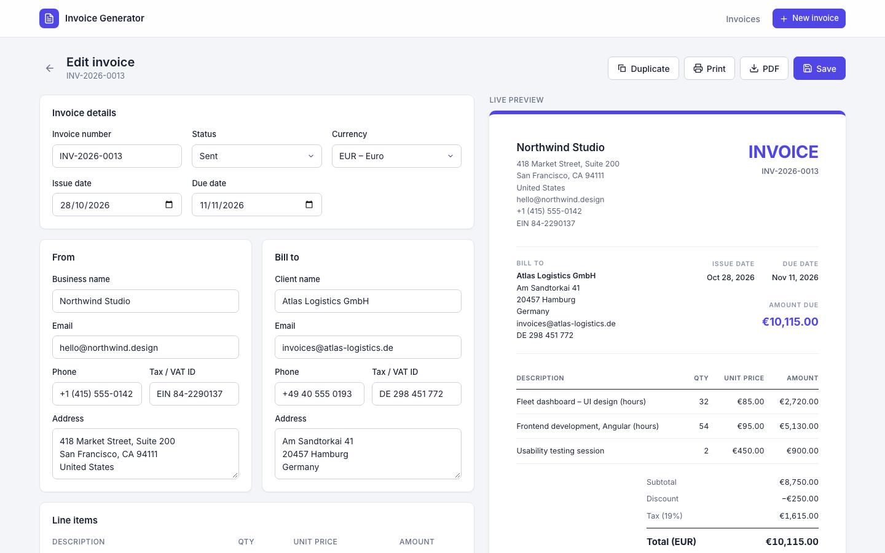

# Invoice Generator

Create, preview and export professional invoices in the browser — no sign-up, no backend.

**[Live Demo →](https://hkhodkar.github.io/invoice-generator/)**



## Features

- **Invoice editor** – business and client details, invoice number, issue/due dates, status, currency and notes
- **Line items** – add or remove rows with quantity and unit price; amounts update as you type
- **Tax & discount** – tax rate in %, discount as a percentage or a fixed amount (applied before tax)
- **Live preview** – the finished invoice renders next to the form and updates on every keystroke
- **PDF export** – generates a clean, text-based A4 PDF with jsPDF (selectable text, ~12 KB per file)
- **Print** – dedicated print stylesheet, so *Print → Save as PDF* works too
- **Invoice list** – search by number or client, filter by status (draft / sent / paid / overdue)
- **Quick actions** – mark as paid, duplicate (new number, today's date, same payment term) and delete
- **Overdue detection** – sent invoices past their due date are highlighted automatically
- **Local persistence** – everything is stored in `localStorage`; three demo invoices are seeded on first visit
- **Unsaved changes guard** – warns before you navigate away from an edited invoice
- **Responsive** – works on desktop, tablet and phone

## Tech Stack

- [Angular 21](https://angular.dev) – standalone components, signals & `computed`, zoneless change detection, built-in control flow (`@if`, `@for`, `@let`)
- Typed reactive forms with `FormArray` for line items and a cross-field date validator
- [jsPDF](https://github.com/parallax/jsPDF) + [jspdf-autotable](https://github.com/simonbengtsson/jsPDF-AutoTable), lazy-loaded only when a PDF is requested
- SCSS with CSS custom properties (no UI library)
- [Vitest](https://vitest.dev) for unit tests
- GitHub Actions + GitHub Pages for deployment

## Getting Started

Requires Node.js 20.19+, 22.12+ or 24+ and npm.

```bash
git clone https://github.com/hkhodkar/invoice-generator.git
cd invoice-generator
npm install
npm start
```

Then open http://localhost:4200.

| Command                       | Description                          |
| ----------------------------- | ------------------------------------ |
| `npm start`                   | Start the dev server                 |
| `npm test -- --watch=false`   | Run the unit tests once              |
| `npm run build`               | Production build into `dist/`        |

## Project Structure

```
src/app
├── core
│   ├── data/            # demo invoices seeded on first load
│   ├── guards/          # unsaved-changes guard
│   ├── models/          # Invoice, LineItem, Party types
│   ├── services/        # InvoiceStore (signals + localStorage), PDF export, toasts
│   └── utils/           # totals calculation, money/date formatting
├── features
│   ├── invoice-list/    # list, search, status filters, quick actions
│   └── invoice-editor/  # typed reactive form + live preview layout
├── layout/header/
├── shared
│   ├── components/      # invoice preview, status badge, icon, toast
│   └── pipes/           # money, shortDate
├── app.routes.ts        # lazy-loaded routes
└── app.config.ts
```

Totals are calculated in one pure function (`core/utils/invoice-calc.ts`) that is shared by the form, the
preview and the PDF, so the numbers always match.

## Author

**Hatef Khodkar** — [github.com/hkhodkar](https://github.com/hkhodkar)

## License

[MIT](LICENSE)
